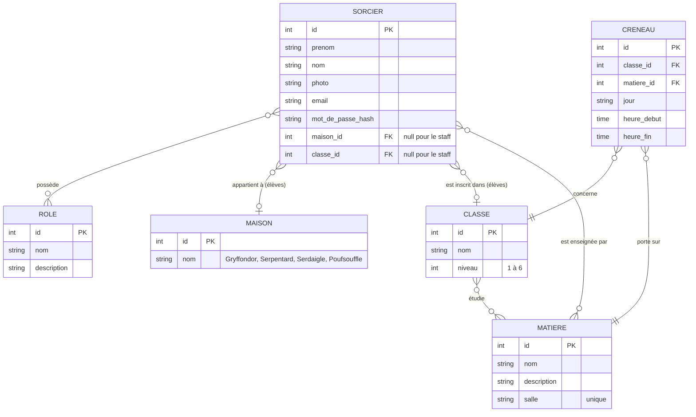

# Cahier des charges — Poudlard's Timetable

> Version du 17/11/2026

## Sommaire

1. [Présentation du projet](#1-présentation-du-projet)
2. [Utilisateurs et droits](#2-utilisateurs-et-droits)
3. [Règles métier](#3-règles-métier)
4. [Fonctionnalités](#4-fonctionnalités)
5. [Pages et routes](#5-pages-et-routes)
6. [Modèle de données](#6-modèle-de-données)
7. [Charte graphique](#7-charte-graphique)
8. [Spécifications techniques](#8-spécifications-techniques)
9. [Organisation et livrables](#9-organisation-et-livrables)
10. [Hors périmètre et évolutions](#10-hors-périmètre-et-évolutions)

---

## 1. Présentation du projet

Poudlard's Timetable est une application web React qui recense les sorciers, les matières, les classes et les rôles de Poudlard pour produire et consulter des emplois du temps.

**Contexte.** Dumbledore et son équipe n'ont pas le temps de gérer les emplois du temps à la main. Ils confient la gestion des données de l'école à une application. La génération des créneaux elle-même est « gérée par la magie » et reste hors périmètre.

**Objectifs**

- Permettre aux gérants de créer, modifier et supprimer les sorciers, matières, classes et rôles.
- Permettre aux élèves de consulter leur emploi du temps, celui de leurs camarades et celui des professeurs.
- Rendre publiques la liste du staff et celle des matières, et protéger le reste par authentification.
- Offrir une interface chaleureuse, fidèle à l'univers du château.

**Cadre.** Projet de groupe réalisé en formation, avec React côté front.

---

## 2. Utilisateurs et droits

Quatre profils utilisent l'application. Les droits dépendent du rôle applicatif, qui est distinct des rôles métier : un professeur peut aussi être directeur de maison.

| Profil | Qui | Connexion |
| --- | --- | --- |
| Visiteur | Toute personne non connectée | Non |
| Élève | Apprenti sorcier rattaché à une classe et à une maison | Oui |
| Professeur / staff | Sorcier non apprenti | Oui |
| Gérant | Membre de l'administration (Dumbledore, McGonagall…) | Oui |

### Matrice des droits

| Action | Visiteur | Élève | Staff | Gérant |
| --- | :---: | :---: | :---: | :---: |
| Voir l'accueil, la liste du staff et celle des matières | ✅ | ✅ | ✅ | ✅ |
| Voir son propre emploi du temps | — | ✅ | ✅ | ✅ |
| Voir l'emploi du temps d'un autre élève ou d'une classe | ❌ | ✅ | ✅ | ✅ |
| Voir l'emploi du temps d'un professeur | ❌ | ✅ | ✅ | ✅ |
| Voir la liste des élèves | ❌ | ✅ | ✅ | ✅ |
| Créer, modifier, supprimer sorciers, classes, matières, rôles | ❌ | ❌ | ❌ | ✅ |

> **Question ouverte :** le staff non gérant a-t-il des droits d'édition, par exemple sur sa propre matière ? Par défaut, non.

---

## 3. Règles métier

Ces règles viennent du sujet. Elles doivent être contrôlées à la fois dans les formulaires et côté données.

| Code | Règle | Conséquence dans l'application |
| --- | --- | --- |
| RG01 | Chaque matière a sa propre salle dédiée | Champ salle obligatoire et unique à la création d'une matière |
| RG02 | Un sorcier peut avoir plusieurs rôles | Multi-sélection des rôles, au moins un rôle requis |
| RG03 | Il existe 6 niveaux de classe | Niveau = valeur de 1 à 6 |
| RG04 | Un apprenti appartient à un seul niveau | Un élève est rattaché à une seule classe |
| RG05 | Tous les sorciers d'une classe ont le même emploi du temps et les mêmes matières | L'emploi du temps est porté par la classe, pas par l'élève |
| RG06 | Un apprenti appartient à une seule maison (Gryffondor, Serpentard, Serdaigle, Poufsouffle) | Maison obligatoire si le rôle « Élève » est coché |
| RG07 | Le staff n'appartient à aucune maison | Champs maison et classe masqués et vides pour un non-apprenti |
| RG08 | Le staff et les matières sont publics, le reste est protégé | Les routes privées redirigent vers la connexion |

> **À trancher en groupe :** un sorcier peut-il être à la fois élève et staff (préfet, capitaine) ? Si oui, RG07 s'applique uniquement aux sorciers sans rôle « Élève ».

---

## 4. Fonctionnalités

Le périmètre tient en sept modules. La priorité MVP correspond au minimum demandé par le sujet.

| ID | Module | En tant que… | Je veux… | Priorité |
| --- | --- | --- | --- | --- |
| US01 | Public | Visiteur | consulter la page d'accueil | MVP |
| US02 | Public | Visiteur | consulter la liste du staff avec leurs rôles et leurs matières | MVP |
| US03 | Public | Visiteur | consulter la liste des matières et leur salle | MVP |
| US04 | Authentification | Utilisateur | me connecter et me déconnecter | MVP |
| US05 | Authentification | Utilisateur non connecté | être redirigé vers la connexion quand j'ouvre une page protégée | MVP |
| US06 | Sorciers | Gérant | lister, rechercher et filtrer les sorciers (maison, niveau, rôle) | MVP |
| US07 | Sorciers | Gérant | ajouter, modifier, supprimer un sorcier | MVP |
| US08 | Sorciers | Gérant | voir les champs maison et classe apparaître seulement si je coche « Élève » | MVP |
| US09 | Classes | Gérant | créer une classe, choisir son niveau et ses matières | MVP |
| US10 | Classes | Gérant | affecter des élèves à une classe | MVP |
| US11 | Matières | Gérant | gérer les matières, leur salle et leur(s) professeur(s) | MVP |
| US12 | Rôles | Gérant | gérer la liste des rôles | MVP |
| US13 | Emplois du temps | Élève | voir mon emploi du temps de la semaine | MVP |
| US14 | Emplois du temps | Élève | voir l'emploi du temps d'un camarade ou d'une classe | MVP |
| US15 | Emplois du temps | Élève | voir l'emploi du temps d'un professeur | MVP |
| US16 | Tableau de bord | Gérant | voir les chiffres clés et la répartition par maison | Bonus |
| US17 | Sorciers | Utilisateur | consulter la fiche détaillée d'un sorcier | Bonus |

### Comportements communs

- Confirmation dans une modale avant toute suppression.
- Message de succès ou d'erreur après chaque enregistrement.
- Validation des formulaires en direct, avec un message par champ.
- État vide et état de chargement sur chaque liste.
- Suppression bloquée si l'élément est utilisé (matière rattachée à une classe, rôle attribué).

---

## 5. Pages et routes

L'application compte 16 écrans : 4 publics, 3 pour les utilisateurs connectés et 9 réservés aux gérants. Les formulaires d'ajout et de modification partagent le même composant.

| Page | Route | Accès |
| --- | --- | --- |
| Accueil | `/` | Public |
| Connexion | `/connexion` | Public |
| Liste du staff | `/staff` | Public |
| Liste des matières | `/matieres` | Public |
| Mon emploi du temps | `/emploi-du-temps` | Connecté |
| Emploi du temps d'une classe, d'un élève ou d'un professeur | `/emploi-du-temps/:type/:id` | Connecté |
| Fiche d'un sorcier | `/sorciers/:id` | Connecté |
| Tableau de bord | `/admin` | Gérant |
| Liste des sorciers | `/admin/sorciers` | Gérant |
| Ajout / modification d'un sorcier | `/admin/sorciers/nouveau`, `/admin/sorciers/:id/modifier` | Gérant |
| Liste des classes | `/admin/classes` | Gérant |
| Ajout / modification d'une classe | `/admin/classes/nouveau`, `/admin/classes/:id/modifier` | Gérant |
| Gestion des matières | `/admin/matieres` | Gérant |
| Ajout / modification d'une matière | `/admin/matieres/nouveau`, `/admin/matieres/:id/modifier` | Gérant |
| Liste des rôles | `/admin/roles` | Gérant |
| Ajout / modification d'un rôle | `/admin/roles/nouveau`, `/admin/roles/:id/modifier` | Gérant |

Une page 404 et une page « accès refusé » complètent la navigation.

---

## 6. Modèle de données

Six entités suffisent. L'emploi du temps est porté par la classe : un élève voit les créneaux de sa classe, un professeur ceux de ses matières.



Trois tables de liaison portent les relations n–n : `sorcier_role`, `classe_matiere` et `matiere_professeur`. Les maisons sont une liste fixe de quatre valeurs.

---

## 7. Charte graphique

L'ambiance retenue est celle d'un château chaleureux : pierre, parchemin, laiton et les quatre couleurs des maisons. Elle remplace la palette fournie par le sujet.

### Palette de base

| Rôle | Nom | Hex |
| --- | --- | --- |
| Fond principal | Parchemin | `#F4EDE1` |
| Cartes et surfaces | Pierre claire | `#E8DFD1` |
| Bordures, séparateurs | Pierre de taille | `#BFB3A2` |
| Texte secondaire | Pierre sombre | `#6E6459` |
| Texte principal, header | Ardoise | `#2A2420` |
| Accent (boutons, liens, focus) | Laiton vieilli | `#A8813F` |

### Maisons

À utiliser uniquement pour les badges, les filtres et les en-têtes de fiche.

| Maison | Hex | Texte dessus |
| --- | --- | --- |
| Gryffondor | `#8E2B2B` | Blanc |
| Serpentard | `#1F5A3E` | Blanc |
| Serdaigle | `#1F3A5F` | Blanc |
| Poufsouffle | `#E2B33C` | Ardoise |

### États

| État | Hex |
| --- | --- |
| Succès | `#3F7A4F` |
| Erreur | `#B0412E` |
| Alerte | `#C98A2E` |

### Variables CSS

```css
:root {
  --color-parchment: #F4EDE1;
  --color-stone-light: #E8DFD1;
  --color-stone: #BFB3A2;
  --color-stone-dark: #6E6459;
  --color-slate: #2A2420;
  --color-brass: #A8813F;

  --color-gryffindor: #8E2B2B;
  --color-slytherin: #1F5A3E;
  --color-ravenclaw: #1F3A5F;
  --color-hufflepuff: #E2B33C;

  --color-success: #3F7A4F;
  --color-error: #B0412E;
  --color-warning: #C98A2E;

  --font-title: 'Cinzel', serif;
  --font-body: 'Source Sans 3', sans-serif;
}
```

### Typographie

- **Titres :** Cinzel
- **Texte et interface :** Source Sans 3

### Principes

- Contraste WCAG AA minimum sur tous les textes.
- Textures de pierre ou de papier réservées au header et à l'accueil, jamais sous du texte dense.
- Les couleurs de maison servent d'information (appartenance), pas de décoration.
- Maquettes réalisées sur Figma en desktop (1440 px), puis déclinées en mobile.

---

## 8. Spécifications techniques

Le front est en React. Les autres choix ci-dessous sont des propositions à valider en groupe.

| Besoin | Proposition |
| --- | --- |
| Socle | React + TypeScript, créé avec Vite |
| Navigation et routes protégées | React Router, avec un composant de garde par niveau d'accès |
| Appels API et cache | TanStack Query (ou fetch / axios dans des services) |
| Formulaires et validation | React Hook Form + Zod |
| État global (utilisateur connecté) | Context React |
| Style | CSS Modules ou Tailwind, avec la palette en variables CSS |
| Authentification | JWT renvoyé par l'API, rôle de l'utilisateur dans le token |
| Données | API fournie, ou json-server en attendant le back |
| Tests | Vitest + Testing Library pour les composants, Playwright pour les parcours clés |
| Qualité | ESLint, Prettier, revue de code sur chaque pull request |

### Exigences non fonctionnelles

- Responsive, du mobile (375 px) au desktop (1440 px).
- Accessibilité : navigation clavier, libellés de formulaire, contraste AA.
- Une route privée ne s'affiche jamais sans token valide ; le contrôle côté API reste la référence.
- Interface entièrement en français.

> **Question ouverte :** une API back est-elle fournie, ou le groupe doit-il la simuler ?

---

## 9. Organisation et livrables

Le projet avance en cinq phases. Les dates et la répartition des rôles restent à fixer par le groupe.

1. **Cadrage** : validation de ce cahier des charges, des règles à trancher et du choix de stack.
2. **Conception** : maquettes Figma, modèle de données, découpage en composants.
3. **Socle** : initialisation du projet, routes, authentification, layout et design system.
4. **Modules** : public, sorciers, classes, matières, rôles, emplois du temps.
5. **Finition** : tests, accessibilité, responsive, déploiement, préparation de la démo.

### Rôles dans le groupe

| Rôle | Membre |
| --- | --- |
| Product owner | |
| Scrum master | |
| Lead front | |
| Référent design / Figma | |
| Référent Git et qualité | |

### Livrables

- [ ] Cahier des charges validé
- [ ] Maquettes Figma (desktop et mobile)
- [ ] Modèle de données
- [ ] Dépôt Git avec README d'installation
- [ ] Application déployée
- [ ] Présentation et démo

### Fonctionnement

- Une branche par fonctionnalité.
- Chaque pull request est relue par un autre membre.
- Tableau Kanban : à faire, en cours, en revue, terminé.

---

## 10. Hors périmètre et évolutions

La génération automatique des créneaux est exclue : selon le sujet, elle est « gérée par la magie ». Les créneaux sont donc fournis par l'API ou saisis comme données de départ.

### Évolutions possibles

- Points de maison et classement en temps réel.
- Export de l'emploi du temps en PDF ou en calendrier (`.ics`).
- Mode sombre « cachots ».
- Notifications de changement de salle ou de cours annulé.
- Gestion des absences.
