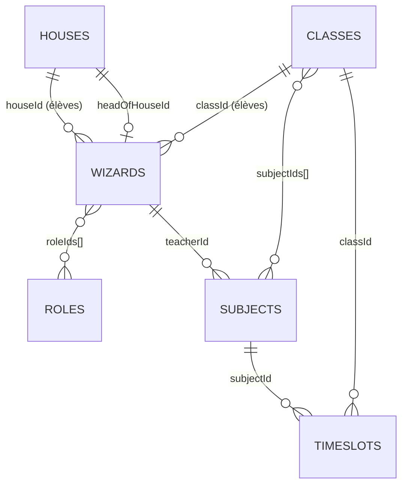

# Guide de la base de données — Poudlard's Timetable

Ce guide décrit le fichier `db.json` utilisé avec **json-server** : ce que contient chaque collection, comment elles sont reliées et quelles requêtes utiliser dans l'application React.

## Sommaire

1. [Lancer le serveur](#1-lancer-le-serveur)
2. [Vue d'ensemble](#2-vue-densemble)
3. [Collections](#3-collections)
4. [Relations](#4-relations)
5. [Requêtes utiles](#5-requêtes-utiles)
6. [Recettes pour l'application](#6-recettes-pour-lapplication)
7. [Données de référence](#7-données-de-référence)
8. [Comptes de test](#8-comptes-de-test)
9. [Limites de json-server](#9-limites-de-json-server)

---

## 1. Lancer le serveur

```bash
npm install json-server
npx json-server db.json --port 3000
```

L'API est alors disponible sur `http://localhost:3000`. Le fichier est surveillé : toute modification de `db.json` est prise en compte, et chaque `POST`, `PATCH` ou `DELETE` réécrit le fichier.

> **Version :** ce guide est écrit pour **json-server v1** (`1.0.0-beta`), la version installée par défaut aujourd'hui. Les requêtes ont été testées avec la `1.0.0-beta.15`. La v0.17 utilise une autre syntaxe pour certains paramètres (voir la [section 9](#9-limites-de-json-server)).

> **Astuce :** gardez une copie propre du fichier (`db.backup.json`) pour pouvoir réinitialiser les données après vos tests.

---

## 2. Vue d'ensemble

| Collection | Contenu | Nombre |
| --- | --- | ---: |
| `houses` | Les 4 maisons | 4 |
| `roles` | Les rôles qu'un sorcier peut avoir | 3 |
| `wizards` | Tous les sorciers : élèves et staff | 65 |
| `subjects` | Les matières, chacune avec sa salle et son professeur | 13 |
| `classes` | Les 6 classes, une par niveau | 6 |
| `timeslots` | Les créneaux de cours de chaque classe | 88 |

Les 65 sorciers se répartissent en **48 élèves** (12 par maison, 8 par classe) et **17 membres du staff**.

Tous les identifiants sont au **format de json-server v1** : une chaîne de 4 caractères hexadécimaux (`"a3f1"`), comme ceux que json-server crée lors d'un `POST`. Les données de départ et celles ajoutées par l'application ont donc le même format.

> **Pourquoi pas `"1"`, `"2"`… ?** json-server v1 convertit en nombre une valeur de filtre qui ressemble à un nombre. Avec des `id` `"1"`, la requête `?classId=1` ne renvoie rien, et si on stocke les clés en nombres, ce sont les `_embed` qui cassent. Les `id` hexadécimaux évitent le problème : aucun n'est lisible comme un nombre.

Les `id` ne sont pas parlants : servez-vous des tableaux de la [section 7](#7-données-de-référence) pour retrouver qui est qui.

---

## 3. Collections

### `houses` — maisons

| Champ | Type | Description |
| --- | --- | --- |
| `id` | string | Identifiant de la maison |
| `name` | string | Nom affiché |
| `founder` | string | Fondateur ou fondatrice |
| `color` | string | Couleur de la maison (hex) |
| `textColor` | string | Couleur du texte à poser sur `color` |
| `emblem` | string | Animal emblème |
| `traits` | string | Valeurs de la maison (ex. « Courage & bravoure ») |
| `commonRoom` | string | Salle commune |

```json
{
  "id": "c3fc",
  "name": "Gryffondor",
  "founder": "Godric Gryffondor",
  "color": "#8E2B2B",
  "textColor": "#FFFFFF",
  "emblem": "Lion",
  "traits": "Courage & bravoure",
  "commonRoom": "Tour de Gryffondor"
}
```

### `roles` — rôles

| Champ | Type | Description |
| --- | --- | --- |
| `id` | string | Identifiant du rôle |
| `name` | string | Clé technique à tester dans le code : `admin`, `staff` ou `user` |
| `label` | string | Nom affiché : Directeur, Professeur, Élève |
| `description` | string | Description courte |

```json
{
  "id": "bbf3",
  "name": "admin",
  "label": "Directeur",
  "description": "Accès complet : gère les sorciers, classes, matières et rôles"
}
```

### `wizards` — sorciers

| Champ | Type | Description |
| --- | --- | --- |
| `id` | string | Identifiant du sorcier |
| `firstName` | string | Prénom |
| `lastName` | string | Nom |
| `email` | string | `prenom.nom@poudlard.uk`, sert d'identifiant de connexion |
| `password` | string | Mot de passe **en clair** (données de démo uniquement) |
| `avatar` | string | URL d'un avatar généré à partir des initiales |
| `roleIds` | string[] | Identifiants des rôles, au moins un (McGonagall est à la fois admin et staff) |
| `houseId` | string \| null | Maison de l'élève, `null` pour le staff |
| `classId` | string \| null | Classe de l'élève, `null` pour le staff |
| `headOfHouseId` | string \| null | Maison dirigée, pour les 4 directeurs de maison |

Exemple d'élève :

```json
{
  "id": "af31",
  "firstName": "Hermione",
  "lastName": "Granger",
  "email": "hermione.granger@poudlard.uk",
  "password": "alohomora",
  "avatar": "https://api.dicebear.com/9.x/initials/svg?seed=Hermione%20Granger",
  "roleIds": [
    "f924"
  ],
  "houseId": "c3fc",
  "classId": "da99",
  "headOfHouseId": null
}
```

Exemple de membre du staff :

```json
{
  "id": "506b",
  "firstName": "Minerva",
  "lastName": "McGonagall",
  "email": "minerva.mcgonagall@poudlard.uk",
  "password": "alohomora",
  "avatar": "https://api.dicebear.com/9.x/initials/svg?seed=Minerva%20McGonagall",
  "roleIds": [
    "bbf3",
    "3fef"
  ],
  "houseId": null,
  "classId": null,
  "headOfHouseId": "c3fc"
}
```

### `subjects` — matières

| Champ | Type | Description |
| --- | --- | --- |
| `id` | string | Identifiant de la matière |
| `name` | string | Nom affiché |
| `room` | string | Salle dédiée à la matière (une salle par matière) |
| `teacherId` | string | `id` du sorcier qui enseigne la matière |
| `description` | string | Description courte |

```json
{
  "id": "fc05",
  "name": "Potions",
  "room": "Cachot de potions",
  "teacherId": "8b5b",
  "description": "Préparer des potions et connaître leurs ingrédients."
}
```

### `classes` — classes

| Champ | Type | Description |
| --- | --- | --- |
| `id` | string | Identifiant de la classe |
| `name` | string | Nom affiché |
| `level` | number | Niveau, de 1 à 6 |
| `subjectIds` | string[] | Matières étudiées par toute la classe |

```json
{
  "id": "145f",
  "name": "1re année",
  "level": 1,
  "subjectIds": [
    "8b48",
    "3b7f",
    "fc05",
    "0fec",
    "94db",
    "0aac",
    "ca3a",
    "e49f"
  ]
}
```

### `timeslots` — créneaux

| Champ | Type | Description |
| --- | --- | --- |
| `id` | string | Identifiant du créneau |
| `classId` | string | Classe concernée |
| `subjectId` | string | Matière enseignée |
| `day` | string | `lundi` à `vendredi` |
| `start` | string | Heure de début, format `HH:mm` |
| `end` | string | Heure de fin, format `HH:mm` |

```json
{
  "id": "725a",
  "classId": "145f",
  "subjectId": "0aac",
  "day": "lundi",
  "start": "09:00",
  "end": "10:30"
}
```

La salle et le professeur ne sont pas stockés dans le créneau : ils se déduisent de la matière (`subject.room`, `subject.teacherId`).

Les créneaux de journée sont 09:00–10:30, 10:45–12:15, 14:00–15:30 et 15:45–17:15. L'astronomie a lieu le soir, à 20:00–21:30 ou à 21:45–23:15.

---

## 4. Relations



| Depuis | Champ | Vers | Type |
| --- | --- | --- | --- |
| `wizards` | `houseId` | `houses` | n–1, `null` pour le staff |
| `wizards` | `classId` | `classes` | n–1, `null` pour le staff |
| `wizards` | `roleIds` | `roles` | n–n, tableau d'`id` |
| `wizards` | `headOfHouseId` | `houses` | 1–1, facultatif |
| `subjects` | `teacherId` | `wizards` | n–1 |
| `classes` | `subjectIds` | `subjects` | n–n, tableau d'`id` |
| `timeslots` | `classId` | `classes` | n–1 |
| `timeslots` | `subjectId` | `subjects` | n–1 |

Les champs `houseId`, `classId` et `subjectId` suivent la convention de json-server : `_embed` permet donc de récupérer l'objet lié dans la même requête. `teacherId` pointe vers `wizards` et non vers une collection `teachers` : il faut donc récupérer le professeur avec une seconde requête. Il en va de même pour les tableaux `roleIds` et `subjectIds`.

---

## 5. Requêtes utiles

### CRUD de base (valable pour toutes les collections)

| Action | Méthode | URL |
| --- | --- | --- |
| Lister | `GET` | `/wizards` |
| Lire un élément | `GET` | `/wizards/440e` (Harry Potter) |
| Créer | `POST` | `/wizards` (objet JSON dans le body) |
| Remplacer | `PUT` | `/wizards/440e` |
| Modifier en partie | `PATCH` | `/wizards/440e` |
| Supprimer | `DELETE` | `/wizards/440e` |

### Filtres, tri, pagination

| Besoin | Requête |
| --- | --- |
| Élèves d'une classe | `/wizards?classId=145f` (1re année) |
| Élèves d'une maison | `/wizards?houseId=c3fc` |
| Staff uniquement | `/wizards?houseId=null` |
| Recherche sur le nom | `/wizards?lastName:contains=Weas` |
| Trier par nom | `/wizards?_sort=lastName` |
| Tri décroissant | `/wizards?_sort=-lastName` |
| Pagination | `/wizards?_page=1&_per_page=10` |
| Matières d'un professeur | `/subjects?teacherId=8b5b` (Rogue) |
| Créneaux d'une classe | `/timeslots?classId=145f` |
| Créneaux d'une matière | `/timeslots?subjectId=fc05` |

Avec `_page`, la réponse n'est plus un tableau mais un objet : les éléments sont dans `data`, et `pages`, `next`, `prev`… servent à la navigation.

### Embarquer les données liées (`_embed`)

| Besoin | Requête |
| --- | --- |
| Un élève avec sa classe et sa maison | `/wizards/440e?_embed=class&_embed=house` |
| Créneaux d'une classe avec leur matière | `/timeslots?classId=145f&_embed=subject` |
| Une classe avec tous ses créneaux | `/classes/145f?_embed=timeslots` |
| Une maison avec tous ses élèves | `/houses/c3fc?_embed=wizards` |

### Supprimer en cascade

`DELETE /classes/ed46?_dependent=timeslots` supprime la classe **et** ses créneaux. Attention : les élèves gardent leur `classId`, qu'il faut remettre à `null` vous-mêmes.

---

## 6. Recettes pour l'application

### Connexion

json-server ne gère pas l'authentification. On simule la connexion en cherchant un sorcier par email et mot de passe :

```js
const API = 'http://localhost:3000';

export async function login(email, password) {
  const res = await fetch(
    `${API}/wizards?email=${encodeURIComponent(email)}&password=${encodeURIComponent(password)}`
  );
  const users = await res.json();
  return users[0] ?? null; // null = identifiants incorrects
}
```

### Savoir si l'utilisateur est gérant ou élève

Un sorcier peut avoir plusieurs rôles : on compare donc les **`name`** des rôles (`admin`, `staff`, `user`), plus parlants que leurs `id`.

```js
export async function getRoles() {
  const res = await fetch(`${API}/roles`);
  return res.json();
}

// ['admin', 'staff'] pour McGonagall, ['user'] pour Harry
export const getRoleNames = (user, roles) =>
  user.roleIds.map((id) => roles.find((r) => r.id === id)?.name);

export const isAdmin = (user, roles) => getRoleNames(user, roles).includes('admin');
export const isStaff = (user, roles) => getRoleNames(user, roles).includes('staff');
export const isStudent = (user, roles) => getRoleNames(user, roles).includes('user');
```

### Liste publique du staff

```js
const [staff, roles] = await Promise.all([
  fetch(`${API}/wizards?houseId=null&_sort=lastName`).then((r) => r.json()),
  fetch(`${API}/roles`).then((r) => r.json()),
]);

const staffWithRoles = staff.map((w) => ({
  ...w,
  roles: w.roleIds.map((id) => roles.find((r) => r.id === id)),
}));
```

### Emploi du temps d'une classe (ou d'un élève)

Un élève a l'emploi du temps de sa classe : on utilise `user.classId`.

```js
export async function getClassTimetable(classId) {
  const res = await fetch(`${API}/timeslots?classId=${classId}&_embed=subject`);
  return res.json(); // chaque créneau contient subject.name, subject.room, subject.teacherId
}
```

### Emploi du temps d'un professeur

Il n'existe pas de lien direct entre un créneau et un professeur. On passe donc par ses matières :

```js
export async function getTeacherTimetable(teacherId) {
  const subjects = await fetch(`${API}/subjects?teacherId=${teacherId}`).then((r) => r.json());
  const slots = await Promise.all(
    subjects.map((s) =>
      fetch(`${API}/timeslots?subjectId=${s.id}&_embed=class`).then((r) => r.json())
    )
  );
  return slots.flat().map((slot) => ({
    ...slot,
    subject: subjects.find((s) => s.id === slot.subjectId),
  }));
}
```

### Ranger les créneaux dans une grille semaine

```js
const DAYS = ['lundi', 'mardi', 'mercredi', 'jeudi', 'vendredi'];

export function toWeekGrid(slots) {
  const grid = Object.fromEntries(DAYS.map((d) => [d, []]));
  slots.forEach((s) => grid[s.day].push(s));
  DAYS.forEach((d) => grid[d].sort((a, b) => a.start.localeCompare(b.start)));
  return grid; // { lundi: [...], mardi: [...], ... }
}
```

### Créer un élève

```js
await fetch(`${API}/wizards`, {
  method: 'POST',
  headers: { 'Content-Type': 'application/json' },
  body: JSON.stringify({
    firstName: 'Dennis',
    lastName: 'Crivey',
    email: 'dennis.crivey@poudlard.uk',
    password: 'alohomora',
    avatar: '',
    roleIds: ['f924'], // rôle user
    houseId: 'c3fc',
    classId: '145f',
    headOfHouseId: null,
  }),
});
```

Pour un membre du staff, `houseId` et `classId` valent `null`. C'est la règle RG07 du cahier des charges.

---

## 7. Données de référence

### Rôles

| `id` | `name` | `label` | Description |
| --- | --- | --- | --- |
| `bbf3` | `admin` | Directeur | Accès complet : gère les sorciers, classes, matières et rôles |
| `3fef` | `staff` | Professeur | Membre du personnel, consulte les emplois du temps |
| `f924` | `user` | Élève | Apprenti sorcier, consulte les emplois du temps |

### Maisons

| `id` | Maison |
| --- | --- |
| `c3fc` | Gryffondor |
| `e53a` | Serpentard |
| `3b02` | Serdaigle |
| `6c48` | Poufsouffle |

### Matières

| `id` | Matière | Salle | Professeur |
| --- | --- | --- | --- |
| `8b48` | Métamorphose | Salle de métamorphose | Minerva McGonagall (`506b`) |
| `3b7f` | Sortilèges | Salle 2E | Filius Flitwick (`7a76`) |
| `fc05` | Potions | Cachot de potions | Severus Rogue (`8b5b`) |
| `0fec` | Défense contre les forces du Mal | Salle 3C | Remus Lupin (`fb00`) |
| `94db` | Botanique | Serre n°3 | Pomona Chourave (`7c76`) |
| `ca3a` | Astronomie | Tour d'astronomie | Aurora Sinistra (`8f86`) |
| `0aac` | Histoire de la magie | Salle 4F | Cuthbert Binns (`bebb`) |
| `8b2c` | Soins aux créatures magiques | Lisière de la Forêt interdite | Rubeus Hagrid (`f6a6`) |
| `c2bd` | Divination | Tour nord | Sibylle Trelawney (`f0fb`) |
| `8da6` | Arithmancie | Salle 7A | Septima Vector (`23c6`) |
| `bd0c` | Étude des runes | Salle 6A | Bathsheda Babbling (`f5da`) |
| `621d` | Étude des Moldus | Salle 1B | Charity Burbage (`2cec`) |
| `e49f` | Vol sur balai | Terrain de Quidditch | Rolanda Bibine (`fb44`) |

### Classes et matières

| Classe | Métamorphose | Sortilèges | Potions | Défense contre les forces du Mal | Botanique | Astronomie | Histoire de la magie | Soins aux créatures magiques | Divination | Arithmancie | Étude des runes | Étude des Moldus | Vol sur balai |
| --- | :---: | :---: | :---: | :---: | :---: | :---: | :---: | :---: | :---: | :---: | :---: | :---: | :---: |
| `145f` | ✅ | ✅ | ✅ | ✅ | ✅ | ✅ | ✅ |  |  |  |  |  | ✅ |
| `da99` | ✅ | ✅ | ✅ | ✅ | ✅ | ✅ | ✅ |  |  |  |  |  |  |
| `88c7` | ✅ | ✅ | ✅ | ✅ | ✅ | ✅ | ✅ | ✅ | ✅ |  |  |  |  |
| `9fc3` | ✅ | ✅ | ✅ | ✅ | ✅ | ✅ | ✅ | ✅ |  | ✅ |  |  |  |
| `f7ea` | ✅ | ✅ | ✅ | ✅ | ✅ | ✅ | ✅ |  | ✅ |  | ✅ |  |  |
| `ed46` | ✅ | ✅ | ✅ | ✅ | ✅ | ✅ | ✅ |  |  | ✅ | ✅ | ✅ |  |

### Staff

| `id` | Nom | Rôles | Directeur de |
| --- | --- | --- | --- |
| `3a8f` | Albus Dumbledore | Directeur |  |
| `506b` | Minerva McGonagall | Directeur, Professeur | Gryffondor |
| `8b5b` | Severus Rogue | Professeur | Serpentard |
| `7a76` | Filius Flitwick | Professeur | Serdaigle |
| `7c76` | Pomona Chourave | Professeur | Poufsouffle |
| `fb00` | Remus Lupin | Professeur |  |
| `8f86` | Aurora Sinistra | Professeur |  |
| `bebb` | Cuthbert Binns | Professeur |  |
| `f6a6` | Rubeus Hagrid | Professeur |  |
| `f0fb` | Sibylle Trelawney | Professeur |  |
| `23c6` | Septima Vector | Professeur |  |
| `f5da` | Bathsheda Babbling | Professeur |  |
| `2cec` | Charity Burbage | Professeur |  |
| `fb44` | Rolanda Bibine | Professeur |  |
| `d660` | Argus Rusard | Professeur |  |
| `a8d4` | Poppy Pomfresh | Professeur |  |
| `1bed` | Irma Pince | Professeur |  |

### Élèves par classe

**1re année** (`145f`)

| `id` | Nom | Maison | Rôles |
| --- | --- | --- | --- |
| `440e` | Harry Potter | Gryffondor | Élève |
| `4f31` | Ron Weasley | Gryffondor | Élève |
| `6ba2` | Drago Malefoy | Serpentard | Élève |
| `b0ae` | Pansy Parkinson | Serpentard | Élève |
| `967a` | Luna Lovegood | Serdaigle | Élève |
| `64cb` | Cho Chang | Serdaigle | Élève |
| `3ce1` | Cedric Diggory | Poufsouffle | Élève |
| `07f8` | Ernie Macmillan | Poufsouffle | Élève |

**2e année** (`da99`)

| `id` | Nom | Maison | Rôles |
| --- | --- | --- | --- |
| `af31` | Hermione Granger | Gryffondor | Élève |
| `ea68` | Neville Londubat | Gryffondor | Élève |
| `e0ca` | Vincent Crabbe | Serpentard | Élève |
| `d8c4` | Gregory Goyle | Serpentard | Élève |
| `8d51` | Padma Patil | Serdaigle | Élève |
| `2c97` | Terry Boot | Serdaigle | Élève |
| `2f82` | Hannah Abbot | Poufsouffle | Élève |
| `efc2` | Justin Finch-Fletchley | Poufsouffle | Élève |

**3e année** (`88c7`)

| `id` | Nom | Maison | Rôles |
| --- | --- | --- | --- |
| `ef78` | Ginny Weasley | Gryffondor | Élève |
| `6e4d` | Dean Thomas | Gryffondor | Élève |
| `fa28` | Blaise Zabini | Serpentard | Élève |
| `15d2` | Théodore Nott | Serpentard | Élève |
| `8baa` | Michael Corner | Serdaigle | Élève |
| `b50a` | Anthony Goldstein | Serdaigle | Élève |
| `f916` | Susan Bones | Poufsouffle | Élève |
| `24a8` | Zacharias Smith | Poufsouffle | Élève |

**4e année** (`9fc3`)

| `id` | Nom | Maison | Rôles |
| --- | --- | --- | --- |
| `3cea` | Seamus Finnigan | Gryffondor | Élève |
| `27d2` | Lavande Brown | Gryffondor | Élève |
| `3e0a` | Millicent Bulstrode | Serpentard | Élève |
| `d841` | Daphné Greengrass | Serpentard | Élève |
| `c2f8` | Marietta Edgecombe | Serdaigle | Élève |
| `824c` | Roger Davies | Serdaigle | Élève |
| `940f` | Eloise Midgen | Poufsouffle | Élève |
| `1f83` | Wayne Hopkins | Poufsouffle | Élève |

**5e année** (`f7ea`)

| `id` | Nom | Maison | Rôles |
| --- | --- | --- | --- |
| `b484` | Colin Crivey | Gryffondor | Élève |
| `e73c` | Fred Weasley | Gryffondor | Élève |
| `969e` | Astoria Greengrass | Serpentard | Élève |
| `58b0` | Marcus Flint | Serpentard | Élève |
| `1c09` | Pénélope Deauclaire | Serdaigle | Élève |
| `caf4` | Marcus Belby | Serdaigle | Élève |
| `6f99` | Megan Jones | Poufsouffle | Élève |
| `eee3` | Owen Cauldwell | Poufsouffle | Élève |

**6e année** (`ed46`)

| `id` | Nom | Maison | Rôles |
| --- | --- | --- | --- |
| `f575` | George Weasley | Gryffondor | Élève |
| `dcad` | Katie Bell | Gryffondor | Élève |
| `6f7e` | Adrian Pucey | Serpentard | Élève |
| `3dfc` | Graham Montague | Serpentard | Élève |
| `941d` | Mandy Brocklehurst | Serdaigle | Élève |
| `014b` | Lisa Turpin | Serdaigle | Élève |
| `692f` | Heidi Macavoy | Poufsouffle | Élève |
| `e8c6` | Laura Madley | Poufsouffle | Élève |

### Exemple : emploi du temps de la 1re année

| Horaire | Lundi | Mardi | Mercredi | Jeudi | Vendredi |
| --- | --- | --- | --- | --- | --- |

Les emplois du temps ont été vérifiés : aucun professeur ni aucune salle n'est occupé deux fois sur le même créneau, et une classe n'a jamais deux fois la même matière dans la journée.

---

## 8. Comptes de test

Tous les comptes ont le mot de passe **`alohomora`**.

| Profil | Email |
| --- | --- |
| admin (directeur) | `albus.dumbledore@poudlard.uk` |
| admin + staff | `minerva.mcgonagall@poudlard.uk` |
| staff (professeur) | `severus.rogue@poudlard.uk` |
| staff sans cours | `argus.rusard@poudlard.uk` |
| user (élève) | `harry.potter@poudlard.uk` |
| user (élève) | `hermione.granger@poudlard.uk` |

---

## 9. Limites de json-server

- **Pas de vraie authentification** : les mots de passe sont en clair et n'importe qui peut appeler l'API. C'est acceptable pour un projet de formation, jamais en production.
- **Pas de validation** : json-server accepte n'importe quel objet. Les règles métier (maison obligatoire pour un élève, niveau de 1 à 6, salle unique…) doivent être vérifiées dans les formulaires React.
- **Pas de filtre sur les tableaux** : `?roleIds=3fef` ne fonctionne pas. Récupérez la liste et filtrez en JavaScript : `wizards.filter((w) => w.roleIds.includes('3fef'))`.
- **Un seul filtre par champ** : `?subjectId=fc05&subjectId=0fec` ne renvoie pas les deux matières. Faites une requête par valeur, ou filtrez côté client.
- **Suppressions** : supprimer un rôle ou une matière ne retire pas leur `id` des tableaux `roleIds` et `subjectIds`. Pensez à nettoyer avec des `PATCH`.
- **Différences avec la v0.17** : `_expand=class` au lieu de `_embed=class` pour un parent ; `_limit` au lieu de `_per_page` ; `?q=` pour la recherche plein texte au lieu de `:contains` ; `_order=desc` au lieu du `-` dans `_sort`.
